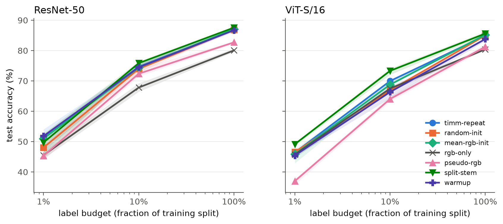

<!--
Figures, tables and numbers.json are produced by experiments/make_figures.py from
results/ only. Lines carrying a "result" comment are checked against numbers.json
by experiments/check_numbers.py in CI.
-->

::: {.callout-warning}
## Draft

This is a working draft shared for review. Every number comes from a run recorded in the repository's `results/` folder and is regenerated from those files; the text has not yet been reviewed by both authors.
:::

Most pretrained vision models expect three input channels. Most satellite imagery has more: Sentinel-2 delivers thirteen, and even the Level-2A product keeps twelve. So the first thing almost everyone does with an ImageNet checkpoint in remote sensing is change the number of input channels and hope for the best. `timm` makes this a one-liner (`timm.create_model(name, pretrained=True, in_chans=13)`), torchgeo's classification trainer calls exactly that line, and the rest of the pipeline never hears about it again.

What happens inside that one-liner is simple, deterministic, and a little arbitrary. This post explains it for convolutional stems and for ViT patch embeddings, shows how much the choice is driven by nothing but band order, compares the default against six alternatives on two Sentinel-2 datasets, and ends with a recipe.

> **Spoiler:** once you fine-tune the whole network, how you initialise the first layer barely matters, as long as you do not throw bands away. On Similar-but-Different the `timm` default reaches 86.9% with a ResNet-50 and 84.9% with a ViT-S/16; a randomly initialised first layer gets 86.8% and 85.0%. <!-- result -->
> Routing R, G, B through the original weights and the other bands through a zero-initialised copy is the one consistent gain: +0.7 points on both models, and +3.4 on the ViT with a tenth of the labels. Squashing the input to pseudo-RGB costs 4.2 and 3.6 points. Which band inherits which kernel moves accuracy by about half a point. <!-- result -->

## What `timm` does today

When the requested `in_chans` differs from the checkpoint's, `timm` looks up the name of the model's first convolution in its pretrained config (`conv1` for ResNets, `stem.0` for ConvNeXt, `patch_embed.proj` for ViTs) and rewrites that one weight tensor with [`adapt_input_conv`](https://github.com/huggingface/pytorch-image-models/blob/12c4939be518a6d02d5d3b47b0b2bed49ad32312/timm/models/_manipulate.py#L293) before loading the state dict.[^builder] Stripped of dtype handling and the single-channel special case, the whole mechanism is:

```python
repeat = math.ceil(in_chans / 3)
weight = weight.repeat(1, repeat, 1, 1)[:, :in_chans]   # R,G,B,R,G,B,...
weight *= 3 / in_chans
```

The pretrained kernels for red, green and blue are tiled along the input dimension and truncated, so band $i$ receives the kernel of RGB channel $i \bmod 3$. The whole tensor is then scaled by $3/N$ so that, if the new bands looked like RGB, the stem's pre-activations would keep their original scale. For a single input channel the three kernels are summed instead. The code comment that accompanies this is admirably honest: "this strategy should be better than random init, but there could be other combinations of the original RGB input layer weights that'd work better for specific cases."

ViTs go through the same function. In `timm`, a patch embedding is an `nn.Conv2d` with kernel size and stride equal to the patch size,[^patch] so its weight has the same `(out, 3, k, k)` shape as a stem convolution and is tiled the same way. The only difference is that a $16 \times 16$ patch kernel is tiled instead of a $7 \times 7$ one. The two cases are shown side by side in Figure 1.

{width=90%}

Two details matter later. First, when $N$ is not a multiple of three the truncation leaves the kernels unevenly represented: with thirteen bands there are five copies of the red kernel and four each of green and blue, so the scaling no longer preserves the sum of input weights and the stem leans slightly red. Second, nothing in the procedure knows what a band is. It only knows its position.

[^builder]: The call happens in [`load_pretrained`](https://github.com/huggingface/pytorch-image-models/blob/ac1f5ce10b8bb89461ee099d12ef51fe4e48ccd8/timm/models/_builder.py#L251) in `timm/models/_builder.py`, which reads `first_conv` from the pretrained config. If the weight cannot be adapted (for example the linear patch embedding of NaFlexViT), the layer is left randomly initialised and the rest of the checkpoint is loaded with `strict=False`. Behaviour quoted from `timm` 1.0.31; the arithmetic is unchanged since at least 0.9.
[^patch]: `PatchEmbed.proj` in [`timm/layers/patch_embed.py`](https://github.com/huggingface/pytorch-image-models/blob/main/timm/layers/patch_embed.py); the ViT pretrained configs set `first_conv='patch_embed.proj'`.

## Band order decides everything

Because band $i$ gets kernel $i \bmod 3$, which pretrained filter a physical band inherits is decided by where that band sits in your array. Table 1 works it out for the two band orders we use in this post.

| Band | Sentinel-2 meaning | Position (SbD, 12 bands) | Kernel inherited | Position (EuroSAT, 13 bands) | Kernel inherited |
|---|---|---:|:---:|---:|:---:|
| B01 | coastal aerosol | 0 | R | 0 | R |
| B02 | blue | 1 | G | 1 | G |
| B03 | green | 2 | B | 2 | B |
| B04 | red | 3 | R | 3 | R |
| B05 | red edge 1 | 4 | G | 4 | G |
| B06 | red edge 2 | 5 | B | 5 | B |
| B07 | red edge 3 | 6 | R | 6 | R |
| B08 | NIR | 7 | G | 7 | G |
| B8A | narrow NIR | 8 | B | 12 | R |
| B09 | water vapour | 9 | R | 8 | B |
| B10 | cirrus | n/a | n/a | 9 | R |
| B11 | SWIR 1 | 10 | G | 10 | G |
| B12 | SWIR 2 | 11 | B | 11 | B |

Table 1: Which pretrained kernel each band inherits under `timm`'s default, for the band order of the Similar-but-Different parquet files and the band order of the EuroSAT GeoTIFFs as loaded by torchgeo. Only the red band lands on the red kernel. Blue gets the green kernel, green gets the blue kernel, and both SWIR bands inherit visible-light filters.

Nobody chose this. The visible bands are swapped because Sentinel-2 numbers them in order of wavelength, starting from a coastal band that most of us never look at. If we reorder the array so that red, green and blue come first, the same code produces a model that at least starts out seeing colour correctly, and everything else inherits whichever kernel the remaining order dictates.

Does the order matter after fine-tuning? Figure 2 fine-tunes the default adapter under five band orders: native, RGB first, reversed, and two random permutations.

{width=80%}

Not after fine-tuning, it turns out. The spread across the five orders is 0.5 points for the ResNet (86.4 to 86.9) and 0.6 for the ViT (84.9 to 85.5), the same size as the seed-to-seed range of any single order. Putting R, G, B first does not help: it is the worst order for the ResNet (86.4) and tied for best on the ViT (85.5). Twenty epochs of end-to-end training are enough for the network to forget which band got which kernel. The arbitrariness is real at initialisation; whether it survives depends on what you do next, which is what the rest of the post is about. <!-- result -->

## Seven ways to plug in N bands

The default is one point in a space of choices. In the Slack thread that started this post, the alternatives came out in about four minutes, and they are all easy to implement on top of `timm`. We compare seven conditions. Each is a few lines in [`adapters.py`](https://github.com/burakekim/channel-adapters/blob/main/src/channel_adapters/adapters.py), and the same code applies to the ResNet stem and the ViT patch embedding because `timm` exposes both as a `Conv2d` named in the pretrained config.

{width=100%}

- **`timm-repeat`.** The default described above. Our baseline.
- **`random-init`.** Throw the pretrained first layer away and initialise a new one with $N$ input channels. The rest of the network is pretrained. This is the reference point the `timm` comment compares itself to.
- **`mean-rgb-init`.** Give every band the same kernel, the mean of the red, green and blue kernels, scaled by $3/N$. This removes the arbitrariness of Table 1 by treating all bands identically, at the cost of starting with no colour sensitivity at all.
- **`rgb-only`.** Ignore the extra bands and feed the untouched model the red, green and blue bands. Not an adapter, but the number every adapter has to beat to justify loading the other bands.
- **`pseudo-rgb`.** Insert a $1 \times 1$ convolution that maps $N$ bands to three pseudo-RGB channels in front of the untouched original first layer. We initialise it to select red, green and blue, so at step zero the model is exactly `rgb-only` and the pretrained network sees the input distribution it was trained on. Fine-tuning can then mix the other bands in.
- **`split-stem`.** Send red, green and blue through the original first layer, send the remaining $N-3$ bands through a parallel copy of that layer initialised to zero, and sum the two outputs. At step zero this is also exactly `rgb-only`; the extra bands enter only as their kernels grow.
- **`warmup`.** Start from `timm-repeat`, but for the first three epochs train only the first layer and the classifier with everything else frozen, then unfreeze. The idea is to let the stem adapt to the new input before the rest of the network has to react to it.

Two of the four alternatives (`pseudo-rgb`, `split-stem`) preserve the "contract" between the first layer and the rest of the network at initialisation; `warmup` tries to re-establish it quickly; `mean-rgb-init` and `random-init` break it in different ways; `timm-repeat` breaks it in the particular way Table 1 describes.

## Setup

**Models.** One convolutional network and one transformer, both ImageNet checkpoints from `timm`: `resnet50.a1_in1k` (first layer `conv1`, a $7 \times 7$ stride-2 convolution) and `vit_small_patch16_224.augreg_in21k` (first layer `patch_embed.proj`, a $16 \times 16$ stride-16 convolution). We resize inputs to $128 \times 128$ and build the ViT with `img_size=128`, so it sees 64 tokens.

**Datasets.** Our main dataset is [Similar-but-Different](https://geospatialml.com/posts/similar-but-different/), 30,927 Sentinel-2 L2A patches of $32 \times 32$ pixels in twelve bands across ten WorldCover classes, built so that RGB alone is insufficient: in that post a fine-tuned ResNet-18 went from 0.71 test accuracy with RGB to 0.82 with all twelve bands. That gap is what makes it a good test of adapters. If the extra bands did not matter, neither would how you plug them in. We use the fixed scene-disjoint split (24,741 / 3,093 / 3,093). Our second dataset is [EuroSAT](https://arxiv.org/abs/1709.00029), 27,000 patches of $64 \times 64$ pixels in thirteen bands across ten classes, with torchgeo's split (16,200 / 5,400 / 5,400). EuroSAT is the dataset most readers know, and also one where RGB already reaches about 98.6%, so we expect small differences there and report it as a sanity check rather than a verdict.

**Protocol.** Full fine-tuning with AdamW, cosine schedule, batch size 256, mixed precision, 20 epochs at the full label budget, flips and 90-degree rotations as the only augmentation. Each band is standardised with its own training-set mean and standard deviation. The learning rate is chosen per model and adapter on the validation split at the full budget (seed 0) from {1e-4, 3e-4, 1e-3, 3e-3}, extended to {1e-2, 3e-2} for the ResNet after every adapter peaked at the top of the first grid; the whole sweep is reported as the sensitivity result. Label budgets of 100%, 10% and 1% of the training split, stratified by class, three seeds each. Linear probes train a logistic regression on frozen features with the regularisation strength swept on validation, as in the Similar-but-Different post.[^probe] Convergence speed is the first epoch at which validation accuracy reaches 95% of its final value. Every run writes one JSON file; every figure below is generated from those files.

[^probe]: Features are the pooled output for the ResNet and the class token for the ViT, standardised; inverse-regularisation strength $C \in \{10^{-3}, 10^{-2}, 10^{-1}, 1, 10\}$, selected on validation, scored on test.

::: {.callout-note}
## What this post does not do

We measure how adapters change downstream accuracy, speed and sensitivity. We do not look inside the fine-tuning process: how large the gradients at and around the adapted layer are compared with RGB inputs, how far that disturbance travels, or how much of the pretraining survives it. Those are the questions we found most interesting while planning this post, and also the ones that need more than a blog post to answer. See the end.
:::

## Results

### Full fine-tuning on Similar-but-Different

{width=95%}

**Five adapters tie, two lose.** With all labels, the five conditions that give the first layer a full view of the twelve bands finish within 0.9 points of each other on the ResNet (86.7 to 87.6) and within 1.8 on the ViT (83.8 to 85.6). The `timm` default sits in the middle of that pack at 86.9 ± 0.5 and 84.9 ± 0.3 (mean ± standard deviation over three seeds); a randomly initialised first layer is indistinguishable from it at 86.8 and 85.0, and so is the mean-RGB kernel at 87.0 and 85.2. The lesson of Figure 2 generalises: with enough labels and a full fine-tune, the first-layer initialisation washes out. <!-- result -->

**`split-stem` is the one consistent gain, and `pseudo-rgb` the one consistent loss.** Routing R, G, B through the original weights and the remaining nine bands through a zero-initialised copy is best on both models, 87.6 ± 0.3 and 85.6 ± 0.5, which is +0.7 points over the default in each case. That is about one standard deviation, so on its own it is suggestive rather than conclusive; the budget and convergence results below make the same point more strongly. Squashing the input to three pseudo-RGB channels before the pretrained stem costs 4.2 points on the ResNet (82.7) and 3.6 on the ViT (81.2). It starts out identical to `rgb-only` and never fully escapes it: a $1 \times 1$ projection to three channels is an information bottleneck, and the pretrained stem downstream was never built to read mixed bands. All twelve bands are worth 6.8 points over RGB on the ResNet and 4.5 on the ViT with the default, so the bottleneck gives back more than half of what the extra bands buy. <!-- result -->

**Warming up the first layer does not help.** Training only the stem and the head for three epochs before unfreezing ends 0.2 points below the default on the ResNet (86.7) and 1.1 below on the ViT (83.8), and it is the slowest condition to converge. Under the same total epoch budget, the three frozen epochs are simply lost. <!-- result -->

### Fewer labels

{width=95%}

**The ViT cares about the adapter when labels are scarce; the ResNet mostly does not.** At 10% of the labels the five full-view adapters span 7.0 points on the ViT but 1.9 on the ResNet. On the ViT, `split-stem` reaches 73.3 against 70.0 for the default (+3.4), 66.9 for random init and 66.3 for warmup; at 1% it is 49.2 against 46.4 (+2.7). On the ResNet the same comparison is 75.8 against 74.6 at 10% (+1.2) and 49.7 against 51.3 at 1% (−1.6), with seed standard deviations of 3.3 to 3.6 points at the 1% budget, so neither ResNet difference means much. `pseudo-rgb` is the clear loser at every budget: on the ViT with 1% labels it finishes at 37.0, below even `rgb-only` at 45.7. <!-- result -->

### Learning-rate sensitivity

{width=95%}

**The two architectures want different things from the learning rate, and the adapters change how forgiving they are.** The ResNet improves monotonically up to 3e-3 for every adapter and degrades beyond 1e-2; across the six rates the full-view adapters move by 7.1 to 9.1 points, so the learning rate matters more than the adapter. The ViT peaks between 1e-4 and 1e-3 and is far flatter for the adapters that preserve the pretrained stem's input: `mean-rgb-init` moves by 1.1 points across the grid and `split-stem` by 1.4, the default by 3.0, warmup by 3.7, and `rgb-only` by 9.1 because it collapses at 3e-3. If you are not going to sweep the learning rate, `split-stem` is the safest choice on the ViT; on the ResNet, sweep it. <!-- result -->

### Convergence

{width=95%}

Counting the first epoch at which validation accuracy reaches 95 percent of its final value, `split-stem` is the fastest condition on the ViT at 5.3 epochs against 7.3 for the default and 9.3 for warmup, and it leads at every epoch of Figure 7. On the ResNet the default and `mean-rgb-init` converge fastest (10.0 and 10.3 epochs); `split-stem` at its selected, higher learning rate takes 13.3, so the speed advantage is a ViT story. `warmup` starts far below everything else on both models, because for three epochs only the stem and the head move, and spends the remaining epochs catching up. <!-- result -->

### Linear probes



Table 2: Linear-probe test accuracy on frozen features, Similar-but-Different, at three label budgets (mean over three subsamples at 10% and 1%). `pseudo-rgb` and `split-stem` are identical to `rgb-only` when frozen, so their rows repeat it. Best value per column in bold.

**Frozen, the default is the only adapter worth having.** A frozen network with a tiled stem sees twelve bands through filters built for three, and it still beats dropping the extra bands, by 1.1 points on the ResNet (60.7 against 59.6) and 1.5 on the ViT (59.9 against 58.5), with similar margins at 10% and 1% labels. The two initialisations that discard the pretrained kernels are much worse when nothing downstream can adapt to them: random init loses 7.5 and 5.2 points to `rgb-only`, mean-RGB init 9.7 and 6.8. The ordering is the reverse of the fine-tuning picture, where mean-RGB init was as good as anything. What the first layer computes matters enormously when it is frozen and hardly at all when it is not. <!-- result -->

### EuroSAT



Table 3: EuroSAT test accuracy at the full label budget. Fine-tuning: mean ± standard deviation over three seeds. Probe: logistic regression on frozen features. Best value per column in bold.

As expected, fine-tuning saturates: every condition lands between 97.8 and 99.1, and the only one that stands out is `random-init` on the ViT at 97.8. The probes repeat the Similar-but-Different ordering with one difference: on EuroSAT the frozen tiled stem is *worse* than `rgb-only` (92.5 against 94.7 on the ResNet, 92.3 against 94.2 on the ViT). The extra bands carry little that EuroSAT needs, so the tiled filters add noise without adding signal; random init loses 16.2 and 15.9 points frozen. Which way the frozen comparison goes depends on whether the extra bands matter for your task, which is exactly what Similar-but-Different was built to make true. <!-- result -->

### Does the first layer's "surprise" predict any of this?

We also measured, at initialisation, the linear CKA between each adapted first layer's output on all bands and the original first layer's output on RGB, hoping the mismatch would predict fine-tuning difficulty. It does not. The three conditions that preserve the pretrained input exactly (`rgb-only`, `pseudo-rgb`, `split-stem`) all score 1.0 and then finish between 0 and 7.5 points apart; the default, random init and mean-RGB init all score about 0.7 and finish within a point of each other. A similarity measure between two linear maps of the same highly correlated input is mostly measuring the input. The numbers are in `results/E5/` for anyone who wants a second look. <!-- result -->

## Conv versus ViT

The mechanism is identical: in both cases one `Conv2d` weight is tiled and rescaled, and the same seven adapters apply unchanged. The ranking is the same too: `split-stem` first, `pseudo-rgb` last among the twelve-band conditions, the default in the middle, on both architectures and both datasets. Where they differ is in how much the choice matters. With all labels the five full-view adapters span 0.9 points on the ResNet and 1.8 on the ViT; with 10% of the labels, 1.9 against 7.0. The ViT is the more sensitive architecture at low budgets, more sensitive to the learning rate for the adapters that break the pretrained input (`rgb-only` loses 9.1 points across the grid, `split-stem` 1.4), and the one where warmup hurts most. One reading is that a patch embedding is a single linear layer feeding directly into attention, so whatever it does at initialisation is seen by every token of every block from the first step, whereas a ResNet stem is followed by a nonlinearity, a max-pool and sixteen residual blocks that can absorb a bad start. We did not test that explanation; it is the kind of question the "surprise" experiments at the end of this post are for. <!-- result -->

## Limitations

Before the takeaways, what we have not tested:

- **Other backbones and sizes.** One ResNet-50 and one ViT-S/16, both ImageNet checkpoints. Larger models, ConvNeXt-style patchify stems, and self-supervised checkpoints such as DINOv2 may behave differently.
- **Other tasks.** Both datasets are patch classification. Segmentation and detection put different demands on the stem.
- **Other sensors and band counts.** Twelve and thirteen Sentinel-2 bands at $128 \times 128$ after resizing. Hyperspectral inputs with hundreds of bands, or SAR plus optical stacks, are a different regime.
- **Other training recipes.** One optimiser, one schedule, three seeds, a four-point learning-rate grid.

If you adopt a recipe from this post, validate it on a representative sample of your own task before committing to it.

## Takeaways

Stated only as strongly as two backbones, two datasets and three seeds allow:

1. **If you fine-tune everything, the `timm` default is fine.** On Similar-but-Different it finishes within 0.9 points (ResNet-50) and 1.8 points (ViT-S/16) of every other initialisation that keeps all twelve bands, including a randomly initialised first layer. Do not spend time replacing it with a cleverer initialisation. <!-- result -->
2. **If you want a free improvement, use `split-stem`.** R, G, B through the original weights, the other bands through a zero-initialised copy, outputs summed. It is +0.7 points over the default on both models with all labels, +3.4 on the ViT with 10% of the labels, the fastest condition to converge on the ViT (5.3 against 7.3 epochs), and the least sensitive to the learning rate. It starts exactly where the RGB model starts, so it can only add. <!-- result -->
3. **Do not squash the input to pseudo-RGB.** A learned projection from N bands to three in front of the pretrained stem costs 4.2 points (ResNet) and 3.6 (ViT) with all labels, and on the ViT with 1% of the labels it is 8.7 points below simply dropping the extra bands. <!-- result -->
4. **Do not bother warming up the first layer.** Under a fixed epoch budget, three epochs of stem-only training end 0.2 (ResNet) and 1.1 (ViT) points below just training everything from the start. <!-- result -->
5. **If the backbone stays frozen, keep the tiled stem, or stay RGB.** Frozen, the default beats `rgb-only` by 1.1 and 1.5 points on Similar-but-Different and loses to it by 2.2 and 1.9 on EuroSAT, depending on whether the extra bands matter for the task. Random or mean-RGB initialisations of a frozen first layer cost 5 to 16 points. <!-- result -->
6. **Band order does not matter once you fine-tune.** Five orders, including two random permutations, differ by 0.5 and 0.6 points. It still decides what the network sees at step zero, so look at Table 1 before trusting a default in any setting where the first layer stays frozen.
7. **Sweep the learning rate for the ResNet.** Every adapter gained 7 to 11 points between 1e-4 and 3e-3, more than any adapter choice is worth. <!-- result -->

## What we did not do, and want to

Caleb's intuition at the start of this project was that tiling the stem breaks the contract between the first layer and everything downstream, and that fine-tuning then has to spend its first steps repairing it. The right way to test that is to look at the gradients at and around the adapted layer and compare them with the gradients the same network produces on RGB inputs, follow how far that disturbance propagates, and measure how much of the pretrained representation is still there afterwards. We started sketching those experiments and stopped, because each of them deserves more care than a blog post can give. They are the natural next step, and if you take it before we do, tell us.

## Try it yourself

Everything in this post is one command per figure. The repository holds the adapters as a small package on top of `timm`, the experiment grid, every run's JSON, and the script that turns those files into the figures above, so the plots regenerate without a GPU. Adapting your own model is three lines:

```python
model = timm.create_model("resnet50.a1_in1k", pretrained=True, num_classes=10)
adapt_model(model, "split-stem", n_bands=12, rgb=[3, 2, 1])   # positions of R, G, B in your band order
```

## Links

- Code, results and this post's source: [github.com/burakekim/channel-adapters](https://github.com/burakekim/channel-adapters)
- `timm`'s [`adapt_input_conv`](https://github.com/huggingface/pytorch-image-models/blob/12c4939be518a6d02d5d3b47b0b2bed49ad32312/timm/models/_manipulate.py#L293) and its caller [`load_pretrained`](https://github.com/huggingface/pytorch-image-models/blob/ac1f5ce10b8bb89461ee099d12ef51fe4e48ccd8/timm/models/_builder.py#L251)
- Dataset: [Similar-but-Different](https://huggingface.co/datasets/calebrob6/similar-but-different) and the [post that introduced it](https://geospatialml.com/posts/similar-but-different/); [EuroSAT](https://github.com/phelber/EuroSAT) via [torchgeo](https://torchgeo.readthedocs.io/)
- Related: [ChannelViT](https://arxiv.org/abs/2309.16108), [DOFA](https://arxiv.org/abs/2403.15356), [IC-ViT](https://arxiv.org/abs/2503.09826) and [CHAMMI](https://arxiv.org/abs/2310.19224) build channel-adaptive models from scratch; this post is about what to do with the RGB checkpoint you already have.
