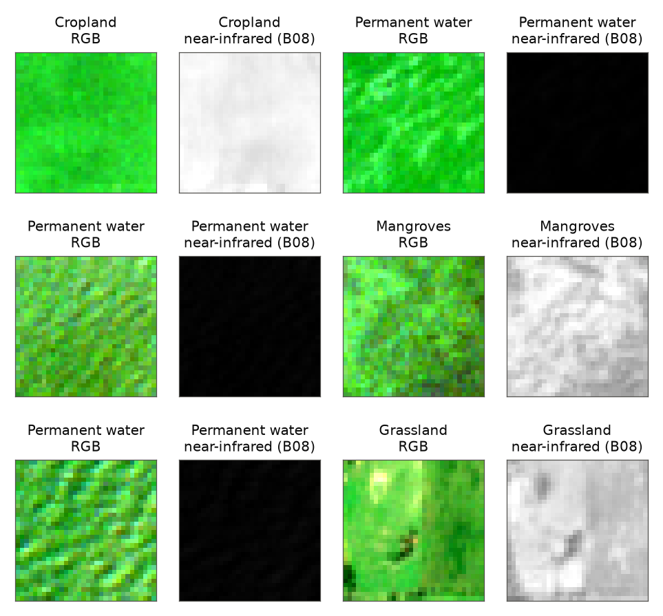
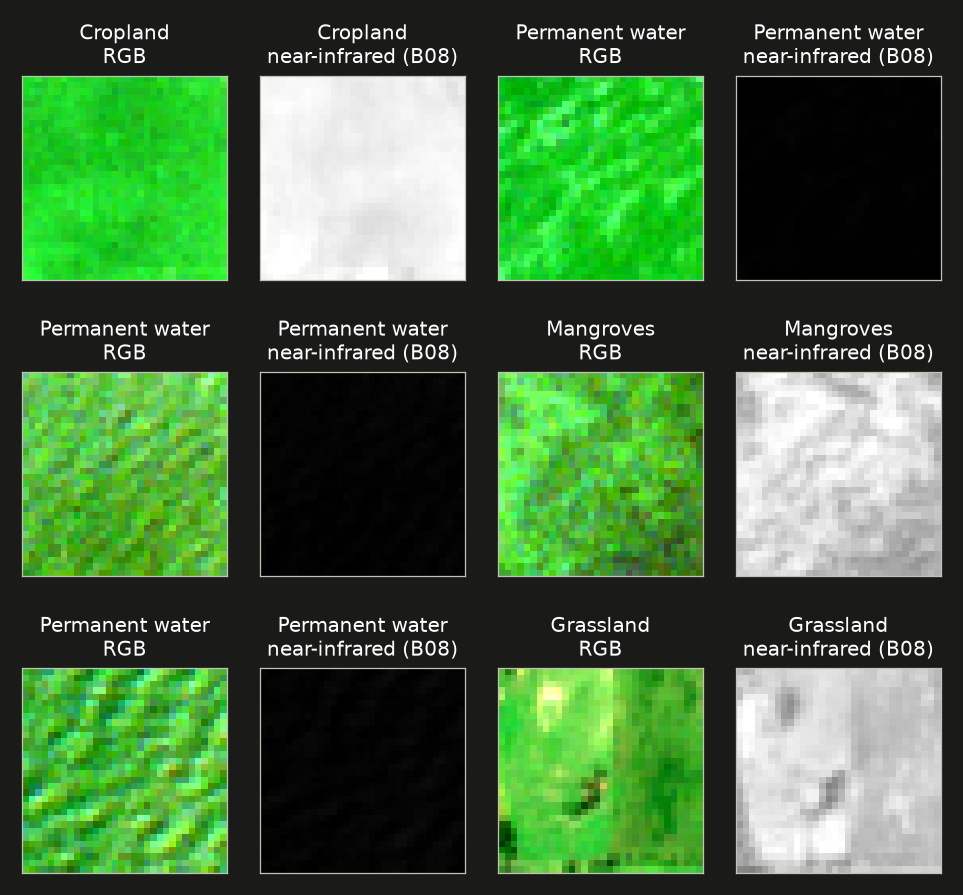
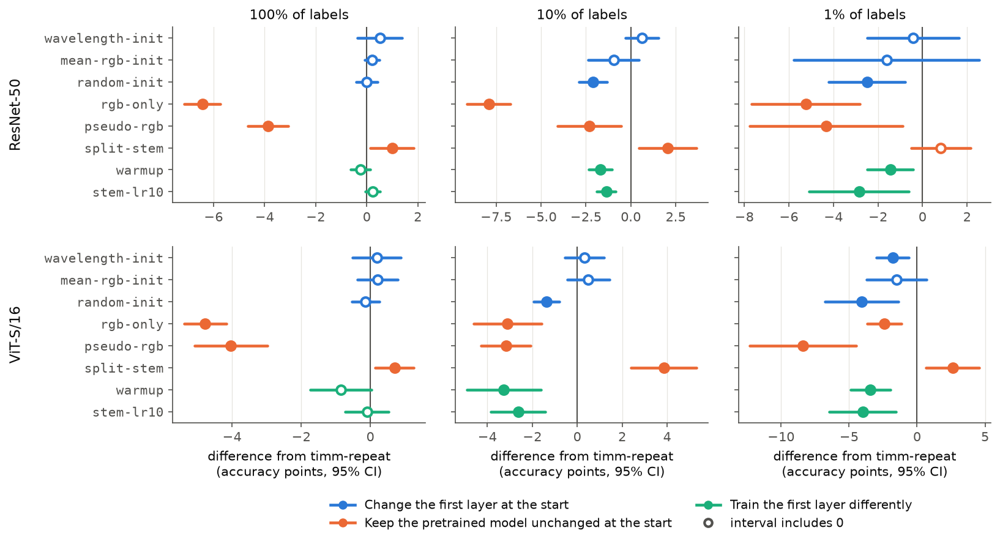
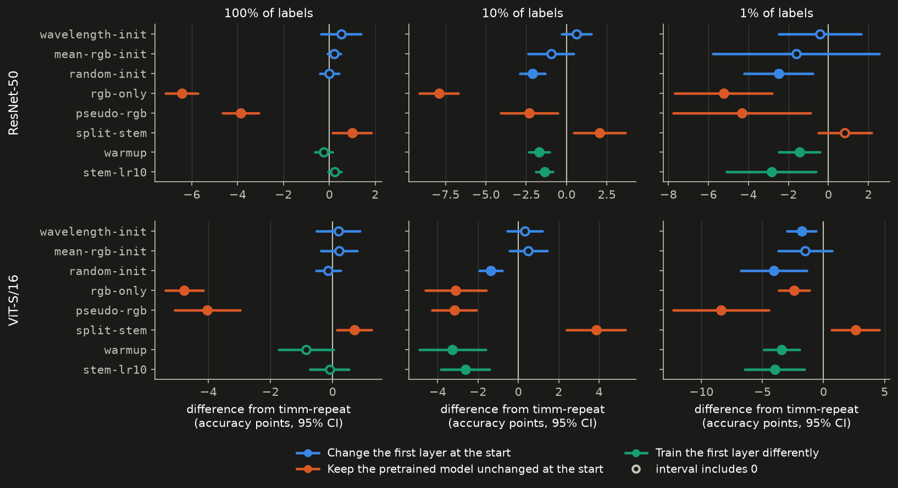
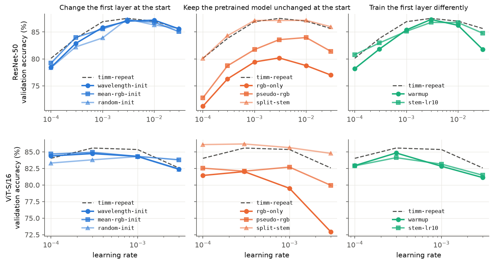
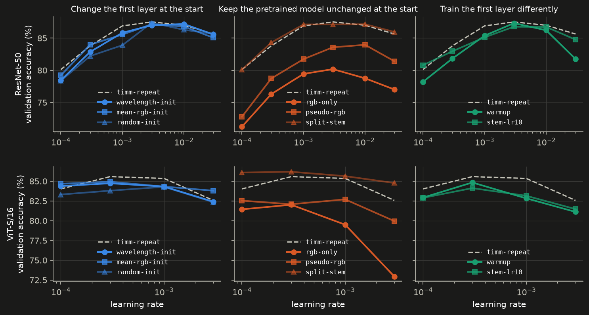

Most pretrained vision models expect three input channels: red, green and blue. Satellite images usually have more. Sentinel-2, for example, records thirteen spectral bands, including near-infrared and shortwave infrared bands that an ImageNet model has never seen. To use an RGB-pretrained model on this data, you have to change its first layer so that it accepts thirteen channels instead of three.

timm does this for you when you pass `in_chans=13` to `timm.create_model`. The pretrained first layer only has filters for red, green and blue, so timm makes enough copies of these three filters to cover every band, drops the copies it does not need, then scales the rest down so the output stays roughly the same size. Which filter a band gets depends only on its position in the input. With the usual Sentinel-2 band order, the blue band gets the green filter, the green band gets the blue filter, and both shortwave infrared bands get filters that were learned for visible light. ViTs are handled the same way, because their patch embedding is also a convolution.

## How timm does it

The work happens in a short function called [`adapt_input_conv`](https://github.com/huggingface/pytorch-image-models/blob/12c4939be518a6d02d5d3b47b0b2bed49ad32312/timm/models/_manipulate.py#L293). When you ask for a number of input channels other than three, timm passes the pretrained first-layer weights through this function before loading them into the model. Those weights have shape `(out_channels, 3, k, k)`: every output channel has one `k × k` filter for red, one for green and one for blue. For any number of bands above one, this is the part that does the work ([source](https://github.com/huggingface/pytorch-image-models/blob/12c4939be518a6d02d5d3b47b0b2bed49ad32312/timm/models/_manipulate.py#L337-L341)):

```python
# NOTE this strategy should be better than random init, but there could be other combinations of
# the original input layer weights that'd work better for specific cases.
repeat = int(math.ceil(in_chans / base_chans))
conv_weight = conv_weight.repeat(1, repeat, 1, 1)[:, :in_chans, :, :]
conv_weight *= base_chans / float(in_chans)
```

The comment on top is the honest part. The authors expect the tiling to beat a random initialisation, but they also say that "there could be other combinations of the original input layer weights that'd work better for specific cases." Multispectral imagery is one of those cases.

`base_chans` is 3 for an RGB checkpoint. For thirteen bands, timm makes five copies of the red, green and blue parts, keeps the first thirteen, and multiplies them by 3/13. The animation below shows each step.

Because thirteen is not a multiple of three, the red filter ends up used five times and green and blue four times each.

::: {.light-content .column-page}
{fig-alt="Animation. Thirteen Sentinel-2 spectral channels are shown in a row. Below them, the red, green and blue parts of one pretrained filter are copied five times to make fifteen parts, the last two are dropped, and the remaining thirteen are scaled by 3/13 and fade. Each channel is then convolved with the part below it and the thirteen results are added into one output."}
:::

::: {.dark-content .column-page}
{fig-alt="Animation. Thirteen Sentinel-2 spectral channels are shown in a row. Below them, the red, green and blue parts of one pretrained filter are copied five times to make fifteen parts, the last two are dropped, and the remaining thirteen are scaled by 3/13 and fade. Each channel is then convolved with the part below it and the thirteen results are added into one output."}
:::

ViTs go through the same function. In timm, a ViT's patch embedding is a convolution whose kernel size and stride both equal the patch size, `nn.Conv2d(in_chans, embed_dim, kernel_size=patch_size, stride=patch_size)` ([source](https://github.com/huggingface/pytorch-image-models/blob/a8ed818888c2f594d9538e5f2d32757554c28571/timm/layers/patch_embed.py#L62)). Its weights have the same `(out_channels, 3, k, k)` shape as a ResNet's first convolution, so timm tiles the 16 × 16 patch filters of a ViT exactly the way it tiles the 7 × 7 filters of a ResNet.

timm's comment calls the tiling better than random, not best. It is the default because it is simple and needs no data. We have not found a study that compares it with the alternatives on multispectral imagery, so we ran that comparison ourselves.

Any way of adding bands has to answer two questions. What should the first layer do with the extra bands when training starts? And should the first layer be trained differently from the rest of the network? We test nine options, grouped below by the question they answer.

- **Change the first layer at the start, but differently from timm.** `wavelength-init` gives each band the filter of the colour nearest to it in wavelength, instead of the filter its position dictates. It is the direct test of whether the position-based assignment costs anything. `mean-rgb-init` gives every band the average of the three filters, and `random-init` starts the first layer from random weights. These two test whether the pretrained filters help at all once the input bands change.
- **Leave the pretrained model unchanged at the start.** `rgb-only` feeds the model only the red, green and blue bands. It is the baseline every other option has to beat if the extra bands carry information. `pseudo-rgb` adds a learned 1 × 1 convolution that maps all bands to three channels and starts by passing red, green and blue through. `split-stem` sends red, green and blue through the original filters and the other bands through a new convolution that starts at zero. Both begin as exactly the RGB model and can learn to use the extra bands during fine-tuning.
- **Train the first layer differently.** Both options start from timm's tiling. `warmup` trains only the first layer and the classifier for the first 15% of training, then everything. `stem-lr10` trains the first layer with a learning rate ten times higher than the rest of the network.

::: {.light-content .column-page}
{fig-alt="Diagram of nine options as rows of twelve cells, one cell per Sentinel-2 band, showing which pretrained filter, average filter, random filter, zero filter or no filter each band starts with."}
:::

::: {.dark-content .column-page}
{fig-alt="Diagram of nine options as rows of twelve cells, one cell per Sentinel-2 band, showing which pretrained filter, average filter, random filter, zero filter or no filter each band starts with."}
:::

The list is not exhaustive. It covers simple options that work with any RGB checkpoint and need no extra data or pretraining. It leaves out models pretrained to accept any set of bands, such as [ChannelViT](https://arxiv.org/abs/2309.16108) and [DOFA](https://arxiv.org/abs/2403.15356). Those answer a different question: what to pretrain, rather than how to reuse a checkpoint you already have.

## Setup

### Datasets

Our main dataset is [Similar-but-Different](https://huggingface.co/datasets/calebrob6/similar-but-different), a Sentinel-2 land-cover benchmark built so that RGB alone is not enough. It has 30,927 patches of 32 × 32 pixels at 10 m, with the 12 bands of the Level-2A product, labelled with 10 ESA WorldCover classes. A patch was kept only if at least 18 of its 20 nearest neighbours in mean-RGB space carry a different label, so a classifier that sees only average colour is wrong on these patches by construction. This property is what makes the comparison informative: if the extra bands carried no useful information, every option would score the same. In the [post that introduced it](https://geospatialml.com/posts/similar-but-different/), a fine-tuned ResNet-18 reaches 0.712 test accuracy from RGB and 0.822 from all 12 bands. We use its fixed split of 24,741 training, 3,093 validation and 3,093 test patches, which keeps every source scene in a single split.

::: {.light-content}
{fig-alt="Three rows of Sentinel-2 patch pairs. In each row two patches with different land-cover labels look alike in RGB but one is bright and the other dark in near-infrared."}
:::

::: {.dark-content}
{fig-alt="Three rows of Sentinel-2 patch pairs. In each row two patches with different land-cover labels look alike in RGB but one is bright and the other dark in near-infrared."}
:::

Our second dataset is [EuroSAT](https://arxiv.org/abs/1709.00029): 27,000 patches of 64 × 64 pixels with all 13 bands of the Level-1C product, in 10 land-use classes. We use the train, validation and test split distributed with [torchgeo](https://github.com/torchgeo/torchgeo), which has 16,200, 5,400 and 5,400 patches. On EuroSAT, the same ResNet-18 recipe reaches 0.986 test accuracy from RGB alone and 0.986 from all 13 bands. EuroSAT therefore cannot reward an option for using the extra bands, but it can expose an option that does harm.

### Models

We use one ImageNet checkpoint from each of the two main architecture families, both from timm. The convolutional model is ResNet-50 (`resnet50.a1_in1k`, trained on ImageNet-1k), whose first layer is a 7 × 7 convolution with stride 2. The transformer is ViT-S/16 (`vit_small_patch16_224.augreg_in21k`, trained on ImageNet-21k), whose first layer is the 16 × 16 patch embedding with stride 16. timm adapts both first layers with the same function. Inputs are resized to 128 × 128 pixels with bilinear interpolation, and the ViT's position embeddings are interpolated to the resulting 8 × 8 grid of patches.

### Training

Every option is trained with the same recipe. Only the first layer differs, and for `warmup` and `stem-lr10`, how it is trained.

| Setting | Value |
|---|---|
| Optimiser | AdamW, weight decay 0.05 |
| Learning-rate schedule | linear warmup over the first 5% of steps, then cosine decay to zero |
| Batch size | 256 |
| Precision | bfloat16 autocast |
| Input | each band standardised with its training-set mean and standard deviation, resized to 128 × 128 |
| Augmentation | random horizontal and vertical flips, random 90° rotations |
| Label budgets | 100%, 10% and 1% of the training split, sampled within each class |
| Training length | 20, 100 and 200 epochs, which is 1,940, 1,000 and 200 optimiser steps |
| Seeds | 5 per configuration |
| Reported metric | test accuracy after the last epoch, without early stopping |

The seed sets the labelled subset, the initialisation of new layers and of the classifier, the order of the data and the augmentation. Every option sees the same labelled subset for a given seed, so options can be compared seed by seed.

The learning rate is tuned separately for every model and option, because an option that changes the first layer may need a different rate. We sweep 1e-4, 3e-4, 1e-3 and 3e-3 on the Similar-but-Different validation split with all labels and seed 0. For ResNet-50 the best rate was the largest one, 3e-3, for every option, so we extended its sweep to 1e-2 and 3e-2. Every selected rate lies inside the swept range. The selected rate is then used for every label budget, every seed and for EuroSAT.

::: {.callout-note collapse="true"}
## Selected learning rates

| Option | ResNet-50 | ViT-S/16 |
|---|---:|---:|
| `timm-repeat` | 3e-3 | 3e-4 |
| `wavelength-init` | 1e-2 | 3e-4 |
| `mean-rgb-init` | 3e-3 | 3e-4 |
| `random-init` | 3e-3 | 1e-3 |
| `rgb-only` | 3e-3 | 3e-4 |
| `pseudo-rgb` | 1e-2 | 1e-3 |
| `split-stem` | 1e-2 | 3e-4 |
| `warmup` | 3e-3 | 3e-4 |
| `stem-lr10` | 3e-3 | 3e-4 |
:::

### Frozen backbone

We also evaluate every option without fine-tuning. The network is frozen right after the option is applied, and a linear classifier is trained on its pooled features: the global average pool for ResNet-50 and the class token for ViT-S/16. The classifier is a multinomial logistic regression on standardised features, with its L2 penalty chosen on the validation split from 1e-4, 1e-3, 1e-2, 1e-1 and 1. At 10% and 1% labels this is repeated on 5 labelled subsets. `warmup` and `stem-lr10` only change training, so frozen they are identical to timm's default and are not listed separately.

### Statistics

For each option we report the mean test accuracy over 5 seeds with its standard deviation. To compare an option with timm's default, we take the difference seed by seed and report its mean with a 95% confidence interval from a paired t-test (4 degrees of freedom). We call a difference clear only when the interval excludes zero. With 5 seeds, differences smaller than about one point often fall inside the interval, and we say so where it matters. In the text, numbers in parentheses after a difference are its 95% confidence interval.

The experiments took 552 training runs, including the learning-rate sweeps, and 14.4 GPU-hours of training on NVIDIA L40S GPUs. <!-- result -->

## Results

### Does the position-based assignment matter?

The timm section showed that which pretrained filter a band receives depends only on where the band sits in the input. We test this in two ways. First, we fine-tune timm's default with the 12 Similar-but-Different bands in five different orders: the dataset's own order, red, green and blue first, reversed, and two random permutations. Second, we compare timm's default with `wavelength-init`, which assigns filters by wavelength and does not depend on band order at all.



Test accuracy (%) after fine-tuning with all labels, mean ± standard deviation over 5 seeds.

Band order does not measurably change the result. The five orders span 0.6 points for ResNet-50 and 0.4 points for ViT-S/16, about the size of the seed-to-seed standard deviation (0.3 and 0.4). A one-way ANOVA across the five orders finds no effect (p = 0.13 and 0.49). Assigning filters by wavelength does not help either: `wavelength-init` differs from timm's default by 0.5 points (−0.4 to 1.4) for ResNet-50 and 0.2 points (−0.5 to 0.9) for ViT-S/16. The mismatch in the animation is real when training starts, but full fine-tuning removes its effect on accuracy. The one exception is ViT-S/16 with 1% of labels, where `wavelength-init` is 1.8 points (0.6 to 3.0) below timm's default. <!-- result -->

### Fine-tuning

The figure below compares every option with timm's default at three label budgets. Each point is the mean difference over 5 seeds, and each bar is its 95% confidence interval. Filled points have intervals that exclude zero. The absolute accuracies are in the table that follows.

::: {.light-content .column-page}
{fig-alt="Forest plot with two rows (ResNet-50, ViT-S/16) and three columns (100%, 10%, 1% of labels). For each option a point and interval show the paired difference from timm-repeat. split-stem lies to the right of zero in most panels; pseudo-rgb and rgb-only lie to the left in all panels."}
:::

::: {.dark-content .column-page}
{fig-alt="Forest plot with two rows (ResNet-50, ViT-S/16) and three columns (100%, 10%, 1% of labels). For each option a point and interval show the paired difference from timm-repeat. split-stem lies to the right of zero in most panels; pseudo-rgb and rgb-only lie to the left in all panels."}
:::

::: {.callout-note collapse="true"}
## Test accuracy on Similar-but-Different after fine-tuning



Test accuracy (%), mean ± standard deviation over 5 seeds. Bold marks the best option in each column.
:::

**The extra bands matter on this dataset.** `rgb-only` is clearly below timm's default in all six settings, by 6.4 points for ResNet-50 and 4.8 points for ViT-S/16 with all labels. This confirms that the comparison can tell the options apart. <!-- result -->

**With all labels, the starting weights of the first layer barely matter.** A first layer started from random weights ends 0.0 points (−0.4 to 0.4) from timm's default for ResNet-50 and 0.1 points (−0.5 to 0.3) below it for ViT-S/16. `mean-rgb-init` and `wavelength-init` are also within their intervals of zero. <!-- result -->

**With fewer labels, the pretrained filters do matter.** At 10% of labels, `random-init` loses 2.1 points (1.3 to 2.9) for ResNet-50 and 1.4 points (0.8 to 1.9) for ViT-S/16. At 1% it loses 2.5 and 4.1 points. Fine-tuning needs enough labelled data to rebuild a first layer from scratch. <!-- result -->

**`split-stem` is the only option that beats timm's default, and it does so in five of six settings.** Its gain is 1.0 points (0.1 to 1.8) for ResNet-50 and 0.7 points (0.1 to 1.3) for ViT-S/16 with all labels. With 10% of labels it grows to 2.1 points (0.5 to 3.7) and 3.9 points (2.4 to 5.3). At 1% of labels the ViT gains 2.6 points (0.7 to 4.6), while the ResNet's gain of 0.8 points has an interval that includes zero (−0.5 to 2.2). `split-stem` has exactly as many first-layer parameters as timm's default (37,632 for ResNet-50), so the gain does not come from a larger model. <!-- result -->

**`pseudo-rgb` is clearly worse than timm's default in all six settings.** It loses 3.9 points for ResNet-50 and 4.0 for ViT-S/16 with all labels, and 8.4 points for ViT-S/16 with 1% of labels. It starts out identical to `rgb-only` and recovers little of the gap: with all labels it is 2.6 points above `rgb-only` for ResNet-50 and 0.7 points above it for ViT-S/16. A likely reason is that the learned layer has to squeeze every band into three channels, which the pretrained filters behind it then read as red, green and blue. <!-- result -->

**Training the first layer differently does not help.** With all labels, `warmup` and `stem-lr10` are within their intervals of timm's default. With 10% and 1% of labels both are clearly worse: `warmup` by 1.7 and 1.4 points for ResNet-50 and by 3.3 and 3.4 points for ViT-S/16; `stem-lr10` by 1.4 and 2.9 points for ResNet-50 and by 2.6 and 4.0 points for ViT-S/16. <!-- result -->

Taken together, the two options that start as exactly the pretrained RGB model are the best (`split-stem`) and among the worst (`pseudo-rgb`) of the nine. What separates them is that `split-stem` gives the extra bands their own filters, while `pseudo-rgb` forces them through the three RGB channels. Starting from the pretrained model is not enough on its own; the extra bands also need a path that does not pass through three channels. Our experiments do not separate how much of `split-stem`'s gain over timm's default comes from each of its two differences: the RGB bands keep their original, unscaled filters, and the other bands start at zero.

### Sensitivity to the learning rate

The figure below shows validation accuracy across the learning-rate sweep, with all labels and seed 0. timm's default is the dashed line in every panel.

::: {.light-content .column-page}
{fig-alt="Six line charts of validation accuracy against learning rate for ResNet-50 (top) and ViT-S/16 (bottom), one panel per group of options, with timm-repeat as a dashed reference line."}
:::

::: {.dark-content .column-page}
{fig-alt="Six line charts of validation accuracy against learning rate for ResNet-50 (top) and ViT-S/16 (bottom), one panel per group of options, with timm-repeat as a dashed reference line."}
:::

The two models want very different learning rates, and for ResNet-50 the choice of rate matters more than the choice of option. Across the sweep, every option's ResNet-50 accuracy changes by 6.0 to 11.2 points, so a poorly chosen rate costs more than any option gains. ViT-S/16 is much less sensitive for most options: `split-stem` changes by 1.4 points across the sweep and timm's default by 3.0. The exception is `rgb-only`, which changes by 9.1 points because it drops sharply at the highest rate. These curves come from a single seed, so we read only their shape and the large differences between them. <!-- result -->

### Frozen backbone

::: {.column-page}

:::

Test accuracy (%) of a linear classifier on frozen features, Similar-but-Different. At 10% and 1% of labels: mean ± standard deviation over 5 labelled subsets. Frozen, `pseudo-rgb` and `split-stem` compute exactly what `rgb-only` computes, and `warmup` and `stem-lr10` are identical to timm's default. Bold marks the best option in each column.

Without fine-tuning, the ranking changes. timm's default is the best frozen option at every label budget for both models, 1.1 points above `rgb-only` for ResNet-50 and 1.5 points for ViT-S/16 with all labels. `random-init` and `mean-rgb-init` lose 5.8 to 10.8 points against it, because a frozen network cannot adapt to filters it was not trained with. `wavelength-init` loses 5.5 points for ResNet-50 and 2.9 points for ViT-S/16. Under wavelength matching, 9 of the 12 bands receive the red filter, so a frozen network sees nine nearly redundant responses. The tiling spreads the three different filters across the bands, which may be why it keeps more information. <!-- result -->

### EuroSAT



Test accuracy (%) on EuroSAT after fine-tuning with all labels, mean ± standard deviation over 5 seeds, at the learning rates selected on Similar-but-Different. Bold marks the best option in each column.



Test accuracy (%) on EuroSAT of a linear classifier on frozen features, all labels.

EuroSAT checks whether an option does harm when the extra bands add little. After fine-tuning, every option lands between 97.7% and 99.1%, and `rgb-only` is among the best for both models. For ResNet-50, every option is within 0.2 points of timm's default. For ViT-S/16, `random-init` loses 1.1 points (0.9 to 1.3), `stem-lr10` 0.6 points and `warmup` 0.4 points, the same options that lost on Similar-but-Different with few labels. `split-stem` is 0.3 points (0.1 to 0.5) above timm's default, so it does no harm here. <!-- result -->

Frozen, the result reverses from Similar-but-Different. `rgb-only` is the best frozen option, 2.2 points above timm's default for ResNet-50 and 1.9 points for ViT-S/16. When the extra bands carry little information, the tiled filters add responses that the frozen network cannot use. <!-- result -->

## Limitations

What we have not tested:

- **Other checkpoints.** Both models are supervised ImageNet checkpoints. Self-supervised checkpoints such as DINOv2 or MAE, larger models, and other stems such as ConvNeXt's 4 × 4 patchify layer may behave differently.
- **Other tasks.** Both datasets are patch classification. Segmentation and detection depend more on fine spatial detail in the first layer.
- **Other inputs.** We use 12 and 13 Sentinel-2 bands on small patches resized to 128 × 128 pixels. Hyperspectral data with hundreds of bands, or radar combined with optical bands, is a different setting.
- **Learning rates at small budgets.** Rates were selected once per model and option, with all labels and one seed. An option could rank differently with rates tuned for 10% or 1% of labels.
- **Small effects.** With 5 seeds, differences below about one point are often not distinguishable from zero.
- **Training schedule.** All runs use the same number of steps. `warmup` spends 15% of them training only the first layer and the classifier; with a longer schedule it might catch up.

## Takeaways

These follow from two models, two datasets and five seeds, and should be read with the limitations above.

1. **If you fine-tune, use `split-stem`.** Send red, green and blue through the original first layer and the other bands through a new layer of the same shape that starts at zero, and add the two outputs. It has the same number of parameters as timm's default, beat it in five of six settings on Similar-but-Different, and did no harm on EuroSAT.
2. **Do not squeeze the bands into three channels.** `pseudo-rgb` was clearly worse than timm's default in every setting on Similar-but-Different, by 2.3 to 8.4 points. <!-- result -->
3. **Band order and wavelength matching do not matter once you fine-tune with all labels.** Five band orders and a wavelength-based assignment all ended within the noise of timm's default. With few labels, wavelength matching did not help either.
4. **Do not change how the first layer is trained.** A first-layer warmup and a ten times higher first-layer learning rate never helped, and both hurt with 10% or 1% of labels.
5. **Keep the pretrained filters when labels are scarce.** A randomly initialised first layer matched timm's default with all labels and fell behind with 10% or 1% of labels.
6. **If the backbone stays frozen, the answer depends on the data.** timm's default was the best frozen option on Similar-but-Different, where the extra bands matter, and `rgb-only` was best on EuroSAT, where they do not.
7. **Tune the learning rate first.** For ResNet-50, moving across the swept learning rates changed accuracy by 6.0 to 11.2 points, more than the gap between any two options that use all the bands. <!-- result -->

`split-stem` is a few lines of PyTorch. This is a simplified version of the module we used:

```python
import torch.nn as nn

class SplitStem(nn.Module):
    """Pretrained layer for R, G, B; a zero-initialised copy for the other bands."""

    def __init__(self, pretrained: nn.Conv2d, n_bands: int, rgb: list[int]):
        super().__init__()
        self.pretrained, self.rgb = pretrained, rgb
        self.other = [i for i in range(n_bands) if i not in rgb]
        self.extra = nn.Conv2d(
            len(self.other), pretrained.out_channels, pretrained.kernel_size,
            pretrained.stride, pretrained.padding, bias=False,
        )
        nn.init.zeros_(self.extra.weight)

    def forward(self, x):
        return self.pretrained(x[:, self.rgb]) + self.extra(x[:, self.other])

# ResNet-50: model.conv1 = SplitStem(model.conv1, 12, rgb=[3, 2, 1])
# ViT:       model.patch_embed.proj = SplitStem(model.patch_embed.proj, 12, rgb=[3, 2, 1])
```

Here `rgb` gives the positions of the red, green and blue bands in your input, in that order. Load the model with `in_chans=3` so that its first layer keeps the pretrained RGB weights.
