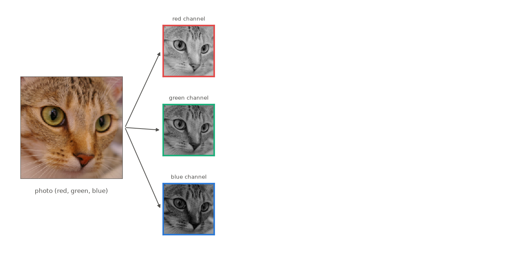
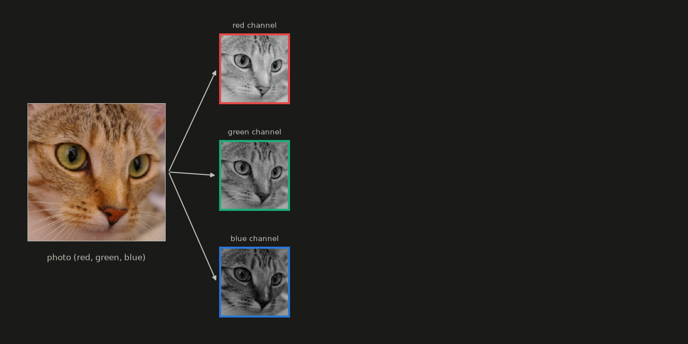

Most pretrained vision models expect three input channels: red, green and blue. Satellite images usually have more. Sentinel-2, for example, records thirteen spectral bands, including near-infrared and shortwave infrared bands that an ImageNet model has never seen. To use an RGB-pretrained model on this data, you have to change its first layer so that it accepts thirteen channels instead of three.

timm does this for you when you pass `in_chans=13` to `timm.create_model`. The pretrained first layer only has filters for red, green and blue, so timm copies these three filters over and over until there is one for every band, then scales them down so the output stays roughly the same size. Which filter a band gets depends only on its position in the input. With the usual Sentinel-2 band order, the blue band gets the green filter, the green band gets the blue filter, and both shortwave infrared bands get filters that were learned for visible light. ViTs are handled the same way, because their patch embedding is also a convolution.

The rest of the network was trained on the outputs of the original RGB filters, so after this change it receives inputs unlike anything it saw during pretraining. There are other ways to add the extra bands. You can map all the bands to three channels with a small learned layer placed before the original first layer. You can send the RGB bands through the original filters and the other bands through a separate new layer. Or you can train only the first layer for a while before training the whole network. In this post we compare timm's approach with these alternatives on a ResNet and a ViT, and measure how much the choice matters when fine-tuning.

## How timm does it

The work happens in a short function called [`adapt_input_conv`](https://github.com/huggingface/pytorch-image-models/blob/12c4939be518a6d02d5d3b47b0b2bed49ad32312/timm/models/_manipulate.py#L293). When you ask for a number of input channels other than three, timm passes the pretrained first-layer weights through this function before loading them into the model. Those weights have shape `(out_channels, 3, k, k)`: every output channel has one `k × k` filter for red, one for green and one for blue. For any number of bands above one, this is the part that does the work ([source](https://github.com/huggingface/pytorch-image-models/blob/12c4939be518a6d02d5d3b47b0b2bed49ad32312/timm/models/_manipulate.py#L337-L341)):

```python
# NOTE this strategy should be better than random init, but there could be other combinations of
# the original input layer weights that'd work better for specific cases.
repeat = int(math.ceil(in_chans / base_chans))
conv_weight = conv_weight.repeat(1, repeat, 1, 1)[:, :in_chans, :, :]
conv_weight *= base_chans / float(in_chans)
```

`base_chans` is 3 for an RGB checkpoint. With thirteen Sentinel-2 bands, the three lines do the following:

1. `repeat` is the number of RGB copies needed to cover all the bands. For thirteen bands that is five.
2. `.repeat(...)` stacks those copies along the input dimension, giving red, green, blue, red, green, blue, and so on, and `[:, :in_chans]` cuts the stack back to thirteen. Band *i* gets the filter of channel *i* mod 3.
3. The last line multiplies every filter by 3/13. The first layer now adds up thirteen filter responses instead of three, and the scaling keeps its output at roughly the original size, as long as the new bands look like RGB.

Because thirteen is not a multiple of three, the red filter ends up used five times and green and blue four times each.


```{=html}
<figure class="tiling-stepper column-screen-inset" id="tiling-stepper" tabindex="0" aria-roledescription="step-through figure">
  
  
  <div class="ts-controls">
    <button type="button" class="btn btn-sm btn-outline-secondary ts-prev" aria-label="Previous step">&larr; Back</button>
    <span class="ts-count" aria-live="polite">Step 1 of 9</span>
    <button type="button" class="btn btn-sm btn-outline-secondary ts-next" aria-label="Next step">Next &rarr;</button>
  </div>
  <p class="ts-text"></p>
  <pre class="ts-code"><code></code></pre>
  <figcaption>One filter from the first layer of an ImageNet-pretrained ResNet-50 (<code>resnet50.a1_in1k</code>), applied to a photo and then, after timm's <code>adapt_input_conv</code>, to a 13-band Sentinel-2 patch from EuroSAT. All weights, images and outputs are real. Cat photo by Stefan van der Walt (CC0), via scikit-image.</figcaption>
</figure>
<style>
  .tiling-stepper { margin: 1.5rem 0; }
  .tiling-stepper .ts-img { width: 100%; height: auto; }
  .tiling-stepper .ts-controls { display: flex; align-items: center; justify-content: center; gap: 1rem; margin: 0.5rem 0; }
  .tiling-stepper .ts-count { font-variant-numeric: tabular-nums; min-width: 7em; text-align: center; }
  .tiling-stepper .ts-text { min-height: 3em; margin: 0 auto 0.5rem; max-width: 50rem; }
  .tiling-stepper .ts-code, .tiling-stepper figcaption { margin-left: auto; margin-right: auto; max-width: 50rem; }
  .tiling-stepper .ts-code { font-size: 0.85em; }
  .tiling-stepper .ts-code[hidden] { display: none; }
</style>
<script>
(function () {
  var STEPS = [{"text": "A photo has three channels: red, green and blue.", "code": null}, {"text": "Every filter in the first layer of an ImageNet model has a separate 7 \u00d7 7 part for each channel. This is one of the 64 filters in the first layer of ResNet-50. Each channel is convolved (\u229b) with its own part.", "code": null}, {"text": "The three results are added together. That sum is the output of this filter.", "code": null}, {"text": "A Sentinel-2 image has 13 bands. The pretrained filter still has only three parts, one for each colour.", "code": null}, {"text": "timm first works out how many copies of the three parts it needs to cover 13 bands: 13 divided by 3, rounded up, which is 5. It then puts 5 copies side by side, which gives 15 parts.", "code": "repeat = int(math.ceil(in_chans / base_chans))   # 13 / 3, rounded up: 5\nconv_weight = conv_weight.repeat(1, repeat, 1, 1)[:, :in_chans, :, :]\n                         ^^^^^^^^^^^^^^^^^^^^^^^^  5 copies: 15 parts"}, {"text": "15 parts is two more than there are bands, so timm keeps the first 13 and drops the last two.", "code": "conv_weight = conv_weight.repeat(1, repeat, 1, 1)[:, :in_chans, :, :]\n                                                 ^^^^^^^^^^^^^^^^^^^^  keep the first 13"}, {"text": "Finally, every part is multiplied by 3/13. The parts are drawn on the same colour scale as before, so you can see them get weaker. The output now adds up 13 responses instead of 3, and the smaller weights keep it at roughly the same size.", "code": "conv_weight *= base_chans / float(in_chans)   # 3 / 13"}, {"text": "Each band is now convolved with the part underneath it: the first band with a red part, the second with a green part, the third with a blue part, the fourth with red again, and so on.", "code": null}, {"text": "The 13 results are added together, just like the three results for the photo. That sum is the output of this filter for the Sentinel-2 image.", "code": null}];
  var fig = document.getElementById("tiling-stepper");
  var imgs = fig.querySelectorAll(".ts-img");
  var text = fig.querySelector(".ts-text"), code = fig.querySelector(".ts-code"), count = fig.querySelector(".ts-count");
  var prev = fig.querySelector(".ts-prev"), next = fig.querySelector(".ts-next");
  var cur = 0;
  function pad(n) { return (n < 10 ? "0" : "") + n; }
  function show(i) {
    cur = Math.max(0, Math.min(STEPS.length - 1, i));
    var n = pad(cur + 1);
    imgs[0].src = "tiling/light_" + n + ".png";
    imgs[1].src = "tiling/dark_" + n + ".png";
    imgs[0].alt = imgs[1].alt = STEPS[cur].text;
    text.textContent = STEPS[cur].text;
    if (STEPS[cur].code) { code.hidden = false; code.firstChild.textContent = STEPS[cur].code; }
    else { code.hidden = true; }
    count.textContent = "Step " + (cur + 1) + " of " + STEPS.length;
    prev.disabled = cur === 0;
    next.disabled = cur === STEPS.length - 1;
  }
  prev.addEventListener("click", function () { show(cur - 1); });
  next.addEventListener("click", function () { show(cur + 1); });
  fig.addEventListener("keydown", function (e) {
    if (e.key === "ArrowRight") { show(cur + 1); e.preventDefault(); }
    if (e.key === "ArrowLeft") { show(cur - 1); e.preventDefault(); }
  });
  for (var k = 1; k <= STEPS.length; k++) {  // preload so stepping does not flicker
    new Image().src = "tiling/light_" + pad(k) + ".png";
    new Image().src = "tiling/dark_" + pad(k) + ".png";
  }
  var m = /tiling-step=(\d+)/.exec(location.hash);
  show(m ? parseInt(m[1], 10) - 1 : 0);
})();
</script>
```

The comment on top is the honest part. The authors expect the tiling to beat a random initialisation, but they also say that "there could be other combinations of the original input layer weights that'd work better for specific cases." Multispectral imagery is one of those cases, and finding out whether a better combination exists is what the rest of this post is about.

ViTs go through the same function. In timm, a ViT's patch embedding is a convolution whose kernel size and stride both equal the patch size, `nn.Conv2d(in_chans, embed_dim, kernel_size=patch_size, stride=patch_size)` ([source](https://github.com/huggingface/pytorch-image-models/blob/a8ed818888c2f594d9538e5f2d32757554c28571/timm/layers/patch_embed.py#L62)). Its weights have the same `(out_channels, 3, k, k)` shape as a ResNet's first convolution, so timm tiles the 16 × 16 patch filters of a ViT exactly the way it tiles the 7 × 7 filters of a ResNet.
