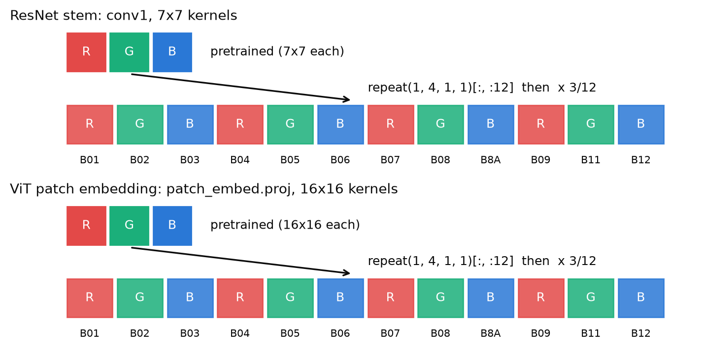
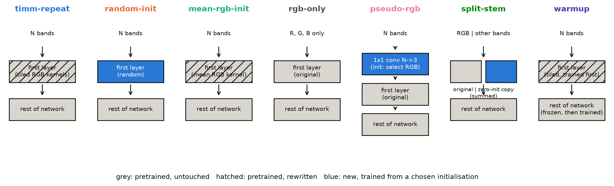
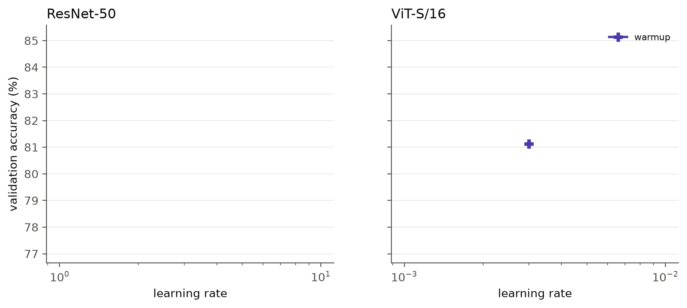
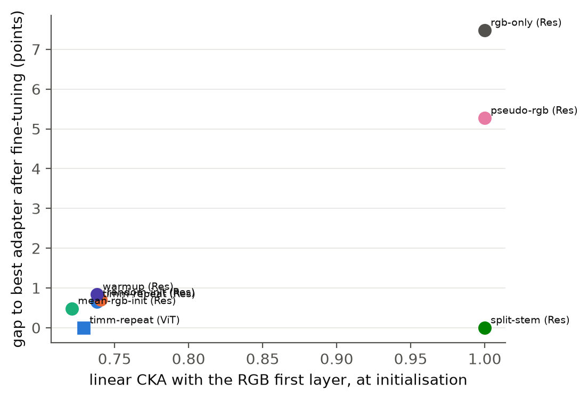

<!--
DRAFT. Every number below that is not a verified fact about code or data is a
TODO(results: Ex) placeholder naming the experiment that will supply it. Figures
are produced by experiments/make_figures.py from results/ only.
Lines ending in a "<!-- result -->" comment are checked against numbers.json by CI.
-->

::: {.callout-warning}
## Draft

This is a work-in-progress draft. Numbers marked **TODO** have not been measured yet; nothing here is a result until the matching file exists in the repository's `results/` folder.
:::

Most pretrained vision models expect three input channels. Most satellite imagery has more: Sentinel-2 delivers thirteen, and even the Level-2A product keeps twelve. So the first thing almost everyone does with an ImageNet checkpoint in remote sensing is change the number of input channels and hope for the best. `timm` makes this a one-liner (`timm.create_model(name, pretrained=True, in_chans=13)`), torchgeo's classification trainer calls exactly that line, and the rest of the pipeline never hears about it again.

What happens inside that one-liner is simple, deterministic, and a little arbitrary. This post explains it for convolutional stems and for ViT patch embeddings, shows how much the choice is driven by nothing but band order, compares the default against six alternatives on two Sentinel-2 datasets, and ends with a recipe.

> **Spoiler:** **TODO(results: E2)**. One sentence with the headline gap between the best adapter and the `timm` default on Similar-but-Different for the ResNet and for the ViT, and whether the ranking agrees across the two.

## What `timm` does today

When the requested `in_chans` differs from the checkpoint's, `timm` looks up the name of the model's first convolution in its pretrained config (`conv1` for ResNets, `stem.0` for ConvNeXt, `patch_embed.proj` for ViTs) and rewrites that one weight tensor with [`adapt_input_conv`](https://github.com/huggingface/pytorch-image-models/blob/12c4939be518a6d02d5d3b47b0b2bed49ad32312/timm/models/_manipulate.py#L293) before loading the state dict.[^builder] Stripped of dtype handling and the single-channel special case, the whole mechanism is:

```python
repeat = math.ceil(in_chans / 3)
weight = weight.repeat(1, repeat, 1, 1)[:, :in_chans]   # R,G,B,R,G,B,...
weight *= 3 / in_chans
```

The pretrained kernels for red, green and blue are tiled along the input dimension and truncated, so band $i$ receives the kernel of RGB channel $i \bmod 3$. The whole tensor is then scaled by $3/N$ so that, if the new bands looked like RGB, the stem's pre-activations would keep their original scale. For a single input channel the three kernels are summed instead. The code comment that accompanies this is admirably honest: "this strategy should be better than random init, but there could be other combinations of the original RGB input layer weights that'd work better for specific cases."

ViTs go through the same function. In `timm`, a patch embedding is an `nn.Conv2d` with kernel size and stride equal to the patch size,[^patch] so its weight has the same `(out, 3, k, k)` shape as a stem convolution and is tiled the same way. The only difference is that a $16 \times 16$ patch kernel is tiled instead of a $7 \times 7$ one. The two cases are shown side by side in Figure 1.

{width=90%}

Two details matter later. First, when $N$ is not a multiple of three the truncation leaves the kernels unevenly represented: with thirteen bands there are five copies of the red kernel and four each of green and blue, so the scaling no longer preserves the sum of input weights and the stem leans slightly red. Second, nothing in the procedure knows what a band is. It only knows its position.

[^builder]: The call happens in [`load_pretrained`](https://github.com/huggingface/pytorch-image-models/blob/ac1f5ce10b8bb89461ee099d12ef51fe4e48ccd8/timm/models/_builder.py#L251) in `timm/models/_builder.py`, which reads `first_conv` from the pretrained config. If the weight cannot be adapted (for example the linear patch embedding of NaFlexViT), the layer is left randomly initialised and the rest of the checkpoint is loaded with `strict=False`. Behaviour quoted from `timm` 1.0.31; the arithmetic is unchanged since at least 0.9.
[^patch]: `PatchEmbed.proj` in [`timm/layers/patch_embed.py`](https://github.com/huggingface/pytorch-image-models/blob/main/timm/layers/patch_embed.py); the ViT pretrained configs set `first_conv='patch_embed.proj'`.

## Band order decides everything

Because band $i$ gets kernel $i \bmod 3$, which pretrained filter a physical band inherits is decided by where that band sits in your array. Table 1 works it out for the two band orders we use in this post.

| Band | Sentinel-2 meaning | Position (SbD, 12 bands) | Kernel inherited | Position (EuroSAT, 13 bands) | Kernel inherited |
|---|---|---:|:---:|---:|:---:|
| B01 | coastal aerosol | 0 | R | 0 | R |
| B02 | blue | 1 | G | 1 | G |
| B03 | green | 2 | B | 2 | B |
| B04 | red | 3 | R | 3 | R |
| B05 | red edge 1 | 4 | G | 4 | G |
| B06 | red edge 2 | 5 | B | 5 | B |
| B07 | red edge 3 | 6 | R | 6 | R |
| B08 | NIR | 7 | G | 7 | G |
| B8A | narrow NIR | 8 | B | 12 | R |
| B09 | water vapour | 9 | R | 8 | B |
| B10 | cirrus | n/a | n/a | 9 | R |
| B11 | SWIR 1 | 10 | G | 10 | G |
| B12 | SWIR 2 | 11 | B | 11 | B |

Table 1: Which pretrained kernel each band inherits under `timm`'s default, for the band order of the Similar-but-Different parquet files and the band order of the EuroSAT GeoTIFFs as loaded by torchgeo. Only the red band lands on the red kernel. Blue gets the green kernel, green gets the blue kernel, and both SWIR bands inherit visible-light filters.

Nobody chose this. The visible bands are swapped because Sentinel-2 numbers them in order of wavelength, starting from a coastal band that most of us never look at. If we reorder the array so that red, green and blue come first, the same code produces a model that at least starts out seeing colour correctly, and everything else inherits whichever kernel the remaining order dictates.

Does the order matter after fine-tuning? Figure 2 fine-tunes the default adapter under five band orders: native, RGB first, reversed, and two random permutations.

{width=80%}

**TODO(results: E0)** Two or three sentences: the spread across orders, whether RGB-first helps, and whether the ViT or the ResNet cares more.

## Seven ways to plug in N bands

The default is one point in a space of choices. In the Slack thread that started this post, the alternatives came out in about four minutes, and they are all easy to implement on top of `timm`. We compare seven conditions. Each is a few lines in [`adapters.py`](https://github.com/burakekim/channel-adapters/blob/main/src/channel_adapters/adapters.py), and the same code applies to the ResNet stem and the ViT patch embedding because `timm` exposes both as a `Conv2d` named in the pretrained config.

{width=100%}

- **`timm-repeat`.** The default described above. Our baseline.
- **`random-init`.** Throw the pretrained first layer away and initialise a new one with $N$ input channels. The rest of the network is pretrained. This is the reference point the `timm` comment compares itself to.
- **`mean-rgb-init`.** Give every band the same kernel, the mean of the red, green and blue kernels, scaled by $3/N$. This removes the arbitrariness of Table 1 by treating all bands identically, at the cost of starting with no colour sensitivity at all.
- **`rgb-only`.** Ignore the extra bands and feed the untouched model the red, green and blue bands. Not an adapter, but the number every adapter has to beat to justify loading the other bands.
- **`pseudo-rgb`.** Insert a $1 \times 1$ convolution that maps $N$ bands to three pseudo-RGB channels in front of the untouched original first layer. We initialise it to select red, green and blue, so at step zero the model is exactly `rgb-only` and the pretrained network sees the input distribution it was trained on. Fine-tuning can then mix the other bands in.
- **`split-stem`.** Send red, green and blue through the original first layer, send the remaining $N-3$ bands through a parallel copy of that layer initialised to zero, and sum the two outputs. At step zero this is also exactly `rgb-only`; the extra bands enter only as their kernels grow.
- **`warmup`.** Start from `timm-repeat`, but for the first three epochs train only the first layer and the classifier with everything else frozen, then unfreeze. The idea is to let the stem adapt to the new input before the rest of the network has to react to it.

Two of the four alternatives (`pseudo-rgb`, `split-stem`) preserve the "contract" between the first layer and the rest of the network at initialisation; `warmup` tries to re-establish it quickly; `mean-rgb-init` and `random-init` break it in different ways; `timm-repeat` breaks it in the particular way Table 1 describes.

## Setup

**Models.** One convolutional network and one transformer, both ImageNet checkpoints from `timm`: `resnet50.a1_in1k` (first layer `conv1`, a $7 \times 7$ stride-2 convolution) and `vit_small_patch16_224.augreg_in21k` (first layer `patch_embed.proj`, a $16 \times 16$ stride-16 convolution). We resize inputs to $128 \times 128$ and build the ViT with `img_size=128`, so it sees 64 tokens.

**Datasets.** Our main dataset is [Similar-but-Different](https://geospatialml.com/posts/similar-but-different/), 30,927 Sentinel-2 L2A patches of $32 \times 32$ pixels in twelve bands across ten WorldCover classes, built so that RGB alone is insufficient: in that post a fine-tuned ResNet-18 went from 0.71 test accuracy with RGB to 0.82 with all twelve bands. That gap is what makes it a good test of adapters. If the extra bands did not matter, neither would how you plug them in. We use the fixed scene-disjoint split (24,741 / 3,093 / 3,093). Our second dataset is [EuroSAT](https://arxiv.org/abs/1709.00029), 27,000 patches of $64 \times 64$ pixels in thirteen bands across ten classes, with torchgeo's split (16,200 / 5,400 / 5,400). EuroSAT is the dataset most readers know, and also one where RGB already reaches about 98.6%, so we expect small differences there and report it as a sanity check rather than a verdict.

**Protocol.** Full fine-tuning with AdamW, cosine schedule, batch size 256, mixed precision, 20 epochs at the full label budget, flips and 90-degree rotations as the only augmentation. Each band is standardised with its own training-set mean and standard deviation. The learning rate is chosen per model and adapter from {1e-4, 3e-4, 1e-3, 3e-3} on the validation split at the full budget (seed 0), and the whole sweep is reported as the sensitivity result. Label budgets of 100%, 10% and 1% of the training split, stratified by class, three seeds each. Linear probes train a logistic regression on frozen features with the regularisation strength swept on validation, as in the Similar-but-Different post.[^probe] Convergence speed is the first epoch at which validation accuracy reaches 95% of its final value. Every run writes one JSON file; every figure below is generated from those files.

[^probe]: Features are the pooled output for the ResNet and the class token for the ViT, standardised; inverse-regularisation strength $C \in \{10^{-3}, 10^{-2}, 10^{-1}, 1, 10\}$, selected on validation, scored on test.

::: {.callout-note}
## What this post does not do

We measure how adapters change downstream accuracy, speed and sensitivity. We do not look inside the fine-tuning process: how large the gradients at and around the adapted layer are compared with RGB inputs, how far that disturbance travels, or how much of the pretraining survives it. Those are the questions we found most interesting while planning this post, and also the ones that need more than a blog post to answer. See the end.
:::

## Results

### Full fine-tuning on Similar-but-Different

{width=95%}

**TODO(results: E2)** Lead paragraph: which adapters beat `timm-repeat`, by how many points, and whether any fail to beat `rgb-only`. <!-- result -->

**TODO(results: E2)** Second paragraph: ResNet versus ViT. <!-- result -->

### Fewer labels

{width=95%}

**TODO(results: E2)** Does the ranking change at 1% and 10%? The initial-contract adapters (`pseudo-rgb`, `split-stem`) have the fewest randomly initialised parameters to learn from few labels, so this is where we expect them to separate, if anywhere. <!-- result -->

### Learning-rate sensitivity

{width=95%}

**TODO(results: E1)** Which adapters are robust to the learning rate and which collapse at 3e-3. <!-- result -->

### Convergence

{width=95%}

**TODO(results: E2)** Epochs to 95% of final accuracy per adapter, and whether the `warmup` stage pays for its three frozen epochs. <!-- result -->

### Linear probes



Table 2: TODO(results: E3) Linear-probe test accuracy on frozen features, Similar-but-Different. `pseudo-rgb` and `split-stem` are identical to `rgb-only` when frozen, so their rows measure the probe's noise. Mean over three subsamples at 10% and 1%.

**TODO(results: E3)** A frozen network with a tiled stem sees twelve bands through filters built for three; the probe tells us whether those features are better or worse than simply dropping the extra bands. <!-- result -->

### EuroSAT



Table 3: TODO(results: E4, E4p) EuroSAT test accuracy, full label budget, mean ± standard deviation over three seeds for fine-tuning. Best value per column in bold.

**TODO(results: E4)** One paragraph. We expect the differences to be within a point. <!-- result -->

### Does the first layer's "surprise" predict any of this?

{width=80%}

**TODO(results: E5)** Kept only if the relationship is visible. If not, we say so in one sentence and drop the figure. <!-- result -->

## Conv versus ViT

**TODO(results: E2, E4)** What is the same (the mechanism, the band-order dependence) and what differs. One hypothesis to test against the data: a ViT patch embedding is a single linear layer followed by attention, so a badly initialised embedding is a linear mistake the first block can partially undo, while a convolutional stem is followed by a nonlinearity and a max-pool before the first residual block. Whether the ViT is therefore more forgiving of `timm-repeat` is an empirical question the figures above answer. <!-- result -->

## Limitations

Before the takeaways, what we have not tested:

- **Other backbones and sizes.** One ResNet-50 and one ViT-S/16, both ImageNet checkpoints. Larger models, ConvNeXt-style patchify stems, and self-supervised checkpoints such as DINOv2 may behave differently.
- **Other tasks.** Both datasets are patch classification. Segmentation and detection put different demands on the stem.
- **Other sensors and band counts.** Twelve and thirteen Sentinel-2 bands at $128 \times 128$ after resizing. Hyperspectral inputs with hundreds of bands, or SAR plus optical stacks, are a different regime.
- **Other training recipes.** One optimiser, one schedule, three seeds, a four-point learning-rate grid.

If you adopt a recipe from this post, validate it on a representative sample of your own task before committing to it.

## Takeaways

**TODO(results: all)** Numbered, each a bold imperative followed by one line of evidence, stated only as strongly as the results support. The shape we expect, to be rewritten from the data:

1. **TODO.** If you can afford to fine-tune everything, ... <!-- result -->
2. **TODO.** If you are label-poor, ... <!-- result -->
3. **TODO.** If you are not going to fine-tune the backbone at all, ... <!-- result -->
4. **Put your bands in a known order and look at Table 1 before trusting a default.** Under `timm`'s tiling, blue inherits the green kernel and both SWIR bands inherit visible-light kernels for the two band orders in this post.

## What we did not do, and want to

Caleb's intuition at the start of this project was that tiling the stem breaks the contract between the first layer and everything downstream, and that fine-tuning then has to spend its first steps repairing it. The right way to test that is to look at the gradients at and around the adapted layer and compare them with the gradients the same network produces on RGB inputs, follow how far that disturbance propagates, and measure how much of the pretrained representation is still there afterwards. We started sketching those experiments and stopped, because each of them deserves more care than a blog post can give. They are the natural next step, and if you take it before we do, tell us.

## Try it yourself

Everything in this post is one command per figure. The repository holds the adapters as a small package on top of `timm`, the experiment grid, every run's JSON, and the script that turns those files into the figures above, so the plots regenerate without a GPU. Adapting your own model is three lines:

```python
model = timm.create_model("resnet50.a1_in1k", pretrained=True, num_classes=10)
adapt_model(model, "TODO(results: all)", n_bands=12, rgb=[3, 2, 1])   # positions of R, G, B in your band order
```

## Links

- Code, results and this post's source: [github.com/burakekim/channel-adapters](https://github.com/burakekim/channel-adapters)
- `timm`'s [`adapt_input_conv`](https://github.com/huggingface/pytorch-image-models/blob/12c4939be518a6d02d5d3b47b0b2bed49ad32312/timm/models/_manipulate.py#L293) and its caller [`load_pretrained`](https://github.com/huggingface/pytorch-image-models/blob/ac1f5ce10b8bb89461ee099d12ef51fe4e48ccd8/timm/models/_builder.py#L251)
- Dataset: [Similar-but-Different](https://huggingface.co/datasets/calebrob6/similar-but-different) and the [post that introduced it](https://geospatialml.com/posts/similar-but-different/); [EuroSAT](https://github.com/phelber/EuroSAT) via [torchgeo](https://torchgeo.readthedocs.io/)
- Related: [ChannelViT](https://arxiv.org/abs/2309.16108), [DOFA](https://arxiv.org/abs/2403.15356), [IC-ViT](https://arxiv.org/abs/2503.09826) and [CHAMMI](https://arxiv.org/abs/2310.19224) build channel-adaptive models from scratch; this post is about what to do with the RGB checkpoint you already have.
